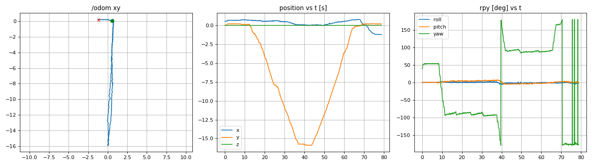

# 2026-11-19 — Revisión offline (antes de las pruebas en el robot)

Datos de bags grabados en el robot, analizados y reproducidos en el PC. **No sustituye a las pruebas del protocolo**: no hay medida real con cinta ni datos de hardware de la NX.

## Bag del pasillo (2026-10-28)

`rosbag2_2026_10_28-10_39_32`: 79 s, pasillo de ~16 m ida y vuelta a mano con el mando, `lio:=true`, `lidar_imu_flip_acc: false`, URDF con el yaw del L1 corregido.

| Qué | Resultado |
|---|---|
| `/utlidar/cloud` | 15.39 Hz, hueco máx. 70 ms |
| `/utlidar/imu` | 248.8 Hz, hueco máx. 12 ms |
| `/Odometry`, `/odom` | 15.39 Hz, hueco máx. 75 ms |
| Latencia nube → `/Odometry` (NX) | p50 15 ms, p95 20 ms |
| Vuelta al inicio (`/odom`) | 4.4 cm a los 68 s, tras 16 m de ida. Conducido a ojo y sin marca en el suelo, así que es una cota optimista |
| Roll / pitch de base_link | ±5° |

No sirve evaluar `/Odometry` directamente: `camera_init` es el marco del L1, montado boca abajo (~165° de pitch), así que su z, roll y pitch no son los del robot. Los números se sacan de `/odom` (base_link).

## Reproducibilidad de la configuración actual

FAST-LIO de `main` (`fast_lio.yaml` con `dense_publish_en`) reproducido sobre las entradas del mismo bag y comparado con el `/Odometry` que se grabó en el robot. El origen de `camera_init` cambia según cuándo arranca FAST-LIO, así que antes se alinean con una transformación rígida:

| | |
|---|---|
| Diferencia mediana | 3.8 cm |
| Diferencia p95 | 8.4 cm |
| Diferencia máxima | 14 cm |

La configuración versionada da lo mismo que el robot.

## `/scan` para EasyNav / slam_toolbox

| Fuente | Haces válidos (de 723) |
|---|---|
| `pointcloud_to_laserscan` sobre una nube (antes) | mediana 58 (8 %) |
| `lio_scan.py`, 1 s de nubes de FAST-LIO (ahora) | mediana 468 (65 %) |

## Localizador de EasyNav solo con velocidades

`config/easynav_real.params.yaml` (cambio del 2026-11-17): el `FusionLocalizer` usa solo las velocidades de `/odom`, porque con la pose el filtro realimentaba su propio `map → odom` y derivaba. Integrar la velocidad de `/odom` frente a su pose en este bag da un error de mediana 0.10 m, máx. 0.33 m y 0.11 m al final, en ~45 m. Es asumible para objetivos de pocos metros; para recorridos largos conviene un localizador que use la pose de FAST-LIO directamente.

## Consumo (PC, i7-12700F; no es la NX)

Réplica en tiempo real, con 100 % = un núcleo:

| Nodo | CPU media | CPU p95 | RAM |
|---|---|---|---|
| `fastlio_mapping` | ~40 % | ~100 % | 155 MB |
| `lio_scan.py` | ~10 % | ~30 % | 70 MB |

Un núcleo de la Orin NX rinde bastante menos que uno del i7: estos números solo sirven de orden de magnitud. La medida válida es L1 del protocolo en la NX.

## Pendiente (protocolo)

L1-L5 y N1-N5 en el robot, con `go2w_metrics` en la NX.
